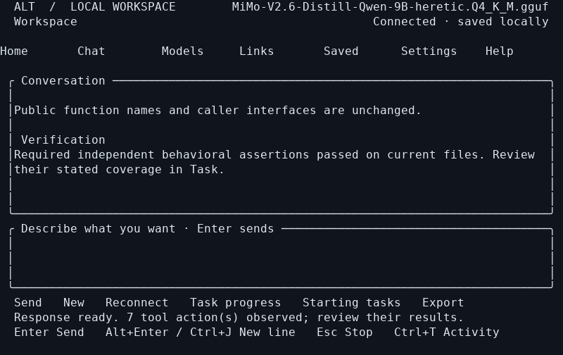

# Alt

[](https://github.com/3d3dcanada/alt-cli/actions/workflows/verify.yml)
[](LICENSE)

**A coding agent in your terminal for the model you choose: local, uncensored or hosted.**

Alt runs a full coding workspace (files, real terminal, checks, undo) around any
model you bring: a GGUF file, Ollama, LM Studio, llama.cpp, vLLM, or a hosted API
such as NVIDIA NIM or OpenRouter. Uncensored, abliterated and standard checkpoints
are all first-class. Alt never swaps your model behind your back, and it shows
what actually changed instead of trusting the model's word.



## 1. Install

Download the latest Linux x86_64 build from
[Releases](https://github.com/3d3dcanada/alt-cli/releases) (see
[Installation](docs/INSTALLATION.md) for checksum and provenance checks), or build it:

```bash
# Debian/Ubuntu prerequisites: git build-essential pkg-config curl ca-certificates python3 libgomp1
git clone https://github.com/3d3dcanada/alt-cli.git
cd alt-cli
cargo build --locked --release      # Rust 1.99.0 is selected automatically
./target/release/alt
```

Alt opens on Home without any configuration. When Home offers **Install agent
engine**, accept it (a pinned, checksummed Goose build). Building Alt downloads no
model weights.

## 2. Connect a model

Choose **Connect a model** on Home (or press **Ctrl+P** and type *connect*):

| You have | Pick | Address it fills |
|---|---|---|
| Ollama | Ollama | `http://127.0.0.1:11434` |
| LM Studio | LM Studio | `http://127.0.0.1:1234/v1` |
| llama.cpp, vLLM, SGLang | *A hosted API or another server preset* → llama.cpp / vLLM | `http://127.0.0.1:8080/v1` / `:8000/v1` |
| A hosted API | *A hosted API or another server preset* → NVIDIA NIM, OpenRouter, Groq, Together, DeepSeek, Mistral, Gemini, Cerebras | the provider's endpoint and key variable |
| A `.gguf` file | *A GGUF file on this computer* | Alt runs it with its own CPU runtime |

Keys stay in your environment: export the variable the preset names (for
example `NVIDIA_API_KEY`) before starting Alt; Alt saves only the variable name.
Pick the model from the server's list (type to search long hosted catalogs).

Headless, the same in one line:

```bash
alt init --preset nvidia --model z-ai/glm-5.3     # or: --preset ollama --model qwen3:8b
alt probe                                          # one short request; suggests settings
```

**Probe this model** (Ctrl+P) sends one bounded request and suggests settings
(thinking off, a larger output allowance, compact tools, native context) that
you can apply with one choice. Thinking models that spend their whole allowance
reasoning are detected and offered a labelled recovery; see
[Small-model usage](docs/SMALL_MODEL_USAGE.md).

## 3. Your first task

1. **Try a practice project** on Home (a small broken example with real checks
   and undo), or **choose a project folder**.
2. **Choose access** in Settings → Tools & access: *Review only*, *Guided changes*
   (reviewed edits, checks isolated with Bubblewrap) or *Full access* (any command
   and network, with your own permissions).
3. Type what you want in the Workspace, for example *"The tests in test_cart.py
   fail; find out why and fix it."* Review each proposed edit or command.
4. Open **Task progress** to see the diff, run the checks and undo if needed. A
   model saying "done" does not mark the work verified; the checks do.

Everything is reachable with the keyboard or mouse: **Ctrl+P** lists every page,
setting and action; **F1** opens help; the TUI stays usable at 80×24.

**Status: 0.7 in development on `main` (latest release 0.6.0 beta 3) · Linux
x86_64 · Apache-2.0.** Model reliability and hardware support are measured
separately from application tests; see [Status and evidence](#status-and-evidence).

## What you can do

| Area | Included |
|---|---|
| Models | Hugging Face search, verified/resumable downloads, multipart GGUF, imported files and server model selection |
| Coding workspace | Browse/search/edit files, inspect diffs, checkpoint Alt edits, undo and resume conversations |
| Terminal | Real PTY sessions, interactive input, resize, attach/detach, persistent jobs, stop/restart and health checks |
| Tools | Native project tools; optional build, Git, HTTP, browser and security workflows; selected external MCP tools |
| Project memory | Saved goals and decisions, pinned notes, incremental source indexing, retrieved context and a visible Context page |
| Verification | Tests/build/lint/health/custom contracts, structured reports, independently pinned assertions and stale-result detection |
| Runtime controls | Context, CPU threads, GPU layers, batch/cache, MoE/tensor offload, RoPE/YaRN, draft models, extra llama-server arguments, generation and restart qualification |
| Any server | Thinking off/low/medium/high per server dialect, penalties, seed, stop, extra request JSON, Ollama context, model probe |
| Small-model effort | Explicit output/sampling, actual request receipts, host workflow, one active skill, source/import outlines and serial independently checked candidates |
| Offline improvement | Development-only instruction proposals with review/rollback; pending trajectory capture, SFT resume/export tooling and verified rewards |
| Recovery | State backup/restore, history retention, preserved imported weights, diagnostics and package rollback |

**Full access** uses normal host permissions. **Guided changes** reviews edits and
uses Bubblewrap for isolated checks; it reports unavailable isolation instead of
silently running on the host. **Review only** is also available. File checkpoints
cover Alt edits; they do not undo arbitrary terminal, database or remote effects.
Tool focus is a separate explicit choice; **All** is the default.

## Models and older computers

| Connection | Address or input | Notes |
|---|---|---|
| Ollama | `http://127.0.0.1:11434` | Use the server root; Alt sends the connection context as `num_ctx` and reads back what Ollama loaded |
| LM Studio | Usually `http://127.0.0.1:1234/v1` | Load a model and start its compatible server first |
| llama.cpp / ORA / other compatible servers | The server's OpenAI-compatible `/v1` address | Tool behavior depends on the model and chat template |
| Managed local inference | A compatible GGUF file or complete split set | The pinned download is CPU first; GPU runtime selection is explicit |
| Hosted APIs | NVIDIA NIM, OpenRouter, Groq, Together, DeepSeek, Mistral, Gemini, Cerebras presets | Key from an environment variable; retries and an output guard for flaky providers |

The reference target is **Linux, 16 GB RAM and a GTX 1070 with 8 GB VRAM**. Physical
GTX 1070 performance has not been measured. Your selected 7B/9B Q4 model is a
deployment target to qualify. Start with 4K–8K context and CPU or measured partial
offload, then test your exact configuration. More
context needs additional memory; project retrieval cannot enlarge a model's
native context window. Pascal GPUs need a compatible CUDA 12 runtime, not a
CUDA 13-only build. CPU mode remains available.

The Hub's variant filter uses publisher labels, not a quality certification.
Qwen Heretic, Spark-X2.5 abliterated and MiMo Heretic derivatives have exploratory
results in the project. The complete 0.6 CPU matrices passed **7/120** pinned
behavioral checks for Spark and **16/120** for Qwen. Manual review and additional
edge cases found unsupported claims and incomplete repairs even among passes.
These are different model/budget configurations, not a matched comparison.
No model preset is promoted. Real LM Studio, private Hub acquisition and GPU
qualification remain open acceptance gates. See [model/runtime qualification](docs/QUALIFICATION.md)
and [live evaluations](docs/LIVE_EVALUATION.md).

## Keyboard and command line

| Action | Control |
|---|---|
| Navigate | Alt+1…9; Alt+0 opens Jobs; Ctrl+P lists every page |
| Help / quick actions | F1 / Ctrl+P |
| Send / newline | Enter / Alt+Enter or Ctrl+J |
| New conversation / project brief | Ctrl+N / Ctrl+B |
| Stop work / quit | Esc / Ctrl+Q |
| Detach from an attached terminal | Ctrl+] |

```bash
alt --help
alt practice
alt doctor
alt hardware
alt models search 'Qwen3 4B heretic'
alt models import /path/to/model.gguf --uncensored --use
alt run 'Inspect this project and explain its test commands'
alt --access trusted run 'Run this project’s checks' --allow-tools --json
# terminal commands and external tools need their own flag:
alt --access trusted run 'Install and test' --allow-terminal --json
alt state backup /path/outside-alt-state/backup.tar.gz
```

[`docs/CLI.md`](docs/CLI.md) covers setup, headless execution, jobs, verification
and export. State defaults to `$XDG_DATA_HOME/alt-cli` or
`~/.local/share/alt-cli`; use `--data-dir` or `ALT_DATA_DIR` to choose another folder.
Keys are referenced by environment-variable name, not saved in model profiles.

## Documentation

- [Small-model implementation plan](docs/SMALL_MODEL_IMPLEMENTATION_PLAN.md) · [Training handoff](training/README.md)
- [Small-model usage](docs/SMALL_MODEL_USAGE.md) · [Delivered work orders and remaining gates](docs/SMALL_MODEL_DELIVERY.md)
- [Installation and updates](docs/INSTALLATION.md) · [Troubleshooting](docs/TROUBLESHOOTING.md)
- [Workspace guide](docs/WORKSPACE_GUIDE.md) · [CLI reference](docs/CLI.md)
- [Verification contracts](docs/VERIFICATION_CONTRACTS.md) · [Runtime qualification](docs/QUALIFICATION.md)
- [Architecture](docs/ARCHITECTURE.md) · [Contributing](CONTRIBUTING.md) · [Changelog](CHANGELOG.md)
- [Implementation and evidence](docs/IMPLEMENTATION.md) · [0.7 work orders](docs/WORK_ORDERS_0.7.md) · [PC test guide](docs/PC_TESTING.md)
- [Research and project history](docs/research/README.md) · [Documentation index](docs/README.md)

Current source validation includes **162 Rust tests**, strict Clippy, both adapter
fixtures for both compact edit formats, and actual small-terminal permission,
edit/check/undo and conversation-continuation journeys. Compact follow-ups retain
the complete original request as context, with the latest user message taking
precedence. The retained 0.6 acceptance also includes five PTY walkthroughs, 30
responsiveness journeys, 60 stream-recovery scenarios and packaged
install/update/rollback checks on Debian 11 and Ubuntu 24.04. The local PC recorder
also passed a live uncensored-model CPU trial. These measurements do not guarantee
that a model can solve an arbitrary task. The [current evidence](docs/evidence/v6/README.md)
separates application results, model outcomes and remaining human/hardware checks.

## Status and evidence

The 2026-10-08 PC trial (GTX 1070, 8 GB) measured why small models fail: reasoning
cut-offs and edit format. Spark-X2.5 4B passed 0/8 tasks at 1,024 output tokens
(every token spent thinking) and 3/8 at 4,096; MiMo 9B abliterated 3/8; hosted Kimi
K3 4/8 and GLM 5.3 3/8. The 0.7 work orders ([board](docs/WORK_ORDERS_0.7.md))
attack exactly that: provider-aware thinking control and cut-off recovery, open
parameters, hosted presets and retries, a model probe and whole-file edits. The
matched re-run on the owner's PC (A10) has not been run yet; no improvement is
claimed until it is.

Earlier results: the [repair follow-up](docs/research/2026-10-07-repair-results/README.md)
has independently verified MiMo 9B Q4 repairs (matched CPU pilot 3/4 per interface;
portable build 6/9). The complete 0.6 CPU matrices passed 7/120 pinned behavioural
checks for Spark and 16/120 for Qwen; no model preset is promoted. Physical GTX 1070
qualification, real LM Studio and novice sessions remain open gates. See
[compatibility](docs/COMPATIBILITY.md), [qualification](docs/QUALIFICATION.md) and
[live evaluations](docs/LIVE_EVALUATION.md). Raw evidence stays in `docs/evidence`;
new raw evidence over 1 MiB goes to release assets (`scripts/check_repo_weight.py`).

## Development and license

```bash
cargo test --locked
cargo fmt --all --check
cargo clippy --locked --all-targets -- -D warnings
```

See [Contributing](CONTRIBUTING.md) for terminal tests, optional tools and the
cloud setup. CI builds and tests a Linux package; successful runs expose a
`linux-build-and-evidence` artifact in [GitHub Actions](https://github.com/3d3dcanada/alt-cli/actions).
Git does not include prebuilt binaries or model weights.

Alt's Rust interface is original project code using a separately installed,
replaceable [Goose ACP engine](https://github.com/aaif-goose/goose). It is not an
OpenCode fork. Alt is licensed under [Apache-2.0](LICENSE); upstream components
and models keep their own licenses. [Third-party provenance](THIRD_PARTY.md)
records versions, attribution and distribution boundaries.
